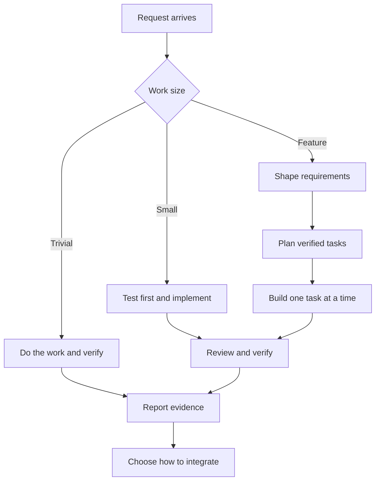

# superpowers


A disciplined development workflow for AI coding agents, where the important steps are **checked by code, not just requested in prose**.

Agents that are told to "write the test first", "get a review" or "verify before claiming success" often skip those steps, especially late in a long session or after the conversation is compacted. superpowers gives the agent a small set of skills describing a good way to work, plus `sp`, a zero-dependency command that keeps a ledger of the work and refuses to close a task until its evidence exists.

```
$ sp done 2
sp: Task 2 cannot be marked done yet:
- no failing run was recorded before a passing one, so there is no evidence the test was written first. ...
- Task 2 is normal risk and has no review; record one with `sp review 2 --verdict ...`
```

> **Independent project.** superpowers by Ethos 6 is an original implementation. It was inspired by the ideas in [obra/superpowers](https://github.com/obra/superpowers) by Jesse Vincent, but it is not affiliated with that project, and no code or text was copied from it. If you want the original, use theirs.

## How it works

```
 request ──► size it ──► trivial:  just do it, verify
                    ├──► small:    sp quick → test-first → sp done → sp finish
                    └──► feature:  shaping → planning → building → shipping
```




1. **shaping**: the agent asks focused questions and writes a short spec with numbered requirements (`R1`, `R2`) and an acceptance check for each (`A1 (R1): ...`). You approve it.
2. **planning**: the spec becomes small tasks. Each one lists the requirements it covers, its risk, a `Verify:` command and a `Done when:` result. `sp plan check` proves every requirement is covered by some task.
3. **building**: `sp next` hands out one task at a time with exactly the requirements and acceptance checks it needs. The agent records a failing test run, then a passing one, gets a review if the task's risk needs it, and closes the task with `sp done`.
4. **shipping**: `sp finish` runs the full test suite, writes a report of every task's evidence, and the agent asks you how to integrate (merge, pull request, or leave it).

Supporting skills cover test-first development, root-cause debugging, verification before claims, giving and receiving code review, delegating to sub-agents, and writing new skills.

## What is enforced by code

| Rule | Enforced by |
|---|---|
| A spec has requirements, each with an acceptance check | `sp spec check` |
| Every requirement is covered by a task; tasks have a verify command and a done condition; malformed task headings are errors, not silently skipped | `sp plan check` |
| Plans record decisions, not pasted implementations (code-line budget per task) | `sp plan check` |
| Only an approved plan (with an approved spec) can be started; one piece of work at a time, and setting work aside archives it with a reason | `sp start`, `sp quick` |
| Test-first evidence: a failing run, then a passing one; with `--match`, a run counts only if its output names the new test | `sp test`, `sp done` |
| The latest run for the task passed | `sp done` |
| Normal and high-risk tasks need an approving review; an approval cannot carry blocker or major findings; high-risk approval must be recorded as coming from a sub-agent or the user | `sp review`, `sp done` |
| Review loops stop after a set number of rounds. Accepting work over open findings needs at least one review round, and is only possible at the round limit or with the user's agreement (always the user for high risk) | `sp review`, `sp rule` |
| The rules a plan started with (test-first, review rounds) cannot be relaxed midway through config | `sp start` snapshot |
| An edited plan or spec must still be marked approved and be synced before any task closes. Every change to a task's rules (risk, test-first, Verify, dependencies) is recorded; changes that make a task easier to close need a reason; a closed task that no longer meets a stricter plan is reopened | `sp sync`, `sp done`, `sp finish` |
| Tasks close only after the tasks they depend on | `sp done` |
| The final full-suite run passes; deferred tasks and overridden test commands are called out | `sp finish` |
| Parallel `sp` runs (for example from sub-agents) do not lose updates; a lock left by a crashed process is taken over safely | ledger lock |
| After a restart or context compaction, the agent is told exactly where the work stands | session-start hook |
| The ledger cannot be changed through the agent's file-editing tools | edit hook |
| Optional: no code edits without an approved plan or declared quick task, and no stopping with a failing active task | edit and stop hooks (`enforce on`) |

The final report lists every recorded run with its command (and how each red run failed), every review finding, every ruling, every refused attempt to close a task, and every plan or spec change with its reason, so anything unusual is visible to the person reading it.

Everything else (asking good questions, writing good tests, reviewing well) is guidance in the skills, kept short enough that the agent actually reads it.

## Compared with obra/superpowers

Both projects share a philosophy (spec, plan, test-first, review, verify). The differences are in approach:

| | obra/superpowers v7 | superpowers (this) |
|---|---|---|
| How steps are enforced | Mostly prose instructions, plus a few helper scripts | A ledger and CLI that refuse to close work without evidence |
| Skill text | about 25,000 words across 15 skills | about 4,300 words across 11 skills (each capped at 600 words by a test) |
| Session-start injection | about 520 words | about 140 words, plus a one-line progress summary |
| Resuming after compaction | Ledger file the agent reads and interprets | Hook tells the agent the exact state; `sp status` / `sp next` resume it |
| Small changes | Process sizing in brainstorming | Explicit `sp quick` path: test-first by default, low risk unless set otherwise |
| Review | Reviewer every task, capped fix loop | By declared risk: low skips review, normal and high require it, high needs an independent reviewer; capped, with recorded rulings |
| Requirement traceability | Not checked | Spec → task coverage checked by `sp plan check` |
| Git ceremony | Worktrees and branch finishing built in | Optional; the user decides how to integrate |
| Hooks | Bash with a Windows polyglot wrapper | Node scripts, same command on every OS |
| Tests | Plugin tests in repo, behavioural evals in a separate repo | 104 offline tests and a mutation check in repo, run on Linux, macOS and Windows; two recorded end-to-end trials |

What obra/superpowers has that this project does not (yet): official listings in several agents' plugin marketplaces, ready-made integrations for many more agents, a visual brainstorming companion, a session-diagnosis skill, a behavioural evaluation suite, and a large community. This project is new.

## Install

### Claude Code

```
/plugin marketplace add Ethos6/superpowers
/plugin install superpowers@ethos6
```

Then ask the agent to "run sp init" in each project where you want the ledger. The plugin's session-start hook tells the agent how to run `sp` in that session (`node "<plugin path>/scripts/sp.cjs" <command>`); `sp` is not added to your own shell's PATH. Requires Node.js 18 or newer.

If you also have obra/superpowers installed, both plugins are named `superpowers`; install only one of them.

### Other agents (Codex, Gemini CLI, Cursor, OpenCode, ...)

Clone this repository and follow [AGENTS.md](AGENTS.md). The skills and `sp` work anywhere; only the automatic hooks are Claude Code specific.

## The `sp` command

```
sp init [--enforce on|off]
sp config [key] [value]
sp spec check <file> [--json]
sp plan check <file> [--json]
sp start <plan> [--force --reason "<why>"]
sp quick "<summary>" [--test-cmd "<cmd>"] [--risk low|normal|high] [--no-tdd "<reason>"] [--force --reason "<why>"]
sp next [--peek] [--json]
sp show <task> [--json]
sp ready [--json]
sp test <task> --expect fail|pass [--match "<text>"] [--tail <lines>] [--timeout <sec>] [-- <command>]
sp review <task> --verdict approve|changes [--by self|agent|user] [--note "<text>"] [--findings <file.json>]
sp rule <task> --accept "<reason>" | --defer "<reason>" [--by self|user]
sp done <task>
sp sync [--reason "<why>"]
sp status [--json]
sp finish [-- <command>]
```

Commands after `--` are run by `/bin/sh` on macOS and Linux, and by Git Bash on Windows (the same shell Claude Code uses), falling back to `cmd.exe`; set `SP_SHELL` to override. Pass several words and they are quoted for you, or one quoted string to use pipes and `&&`. When the command finishes, times out (`--timeout`), or `sp` is interrupted, the command's whole process tree is stopped, so leftover background processes cannot keep `sp` waiting. A command killed by a signal counts as a failing run.

State lives in `.superpowers/` in your project (it git-ignores itself): `config.json`, `state.json`, an event log, and finished reports. Exit codes: `0` ok, `1` a rule was not met, `2` usage error, `3` internal error.

### Enforcement levels

- `enforce off` (default): `sp` enforces its rules whenever the agent uses it, and the ledger is protected from the agent's file-editing tools. Nothing blocks the agent's other work.
- `enforce on` (`sp config enforce on`): the agent cannot edit code files until an approved plan is started or a quick task is declared (Markdown, `.rst`, `.adoc` and the `docs/` folder stay editable), and it is stopped once if it tries to end its turn while an active task has no passing check.

## Limits

- `sp` does not look at the code: it cannot tell whether code changed after an approving review.
- `sp` proves that a failing run was followed by a passing one, and that reviews were recorded. It cannot prove the test was meaningful, the failure was for the right reason, or the review was thorough. The skills and reviewer prompt address that, and the report lists every command so a person can check.
- Approval and reviewer identity are declared, not verified. `Status: approved`, `--by agent` and `--by user` record what the agent says happened. They make skipped steps visible in the report rather than impossible.
- The hooks watch the agent's file-editing tools. Shell commands can still change files, including `.superpowers/`, and `sp config enforce off` switches the gate off. Config changes are logged in `.superpowers/log.jsonl`, and the rules a plan started with stay in force. The gate is a guard rail, not a sandbox.
- Hooks fail open: if a hook errors, the agent is not blocked.
- On Windows, processes a command leaves running in the background after it exits are not always found, because Windows has no process groups; `--timeout` and interrupts still stop the main tree. In the `cmd.exe` fallback (no Git Bash), `%VARIABLES%` in quoted arguments are still expanded.
- The stop and session-start hooks find the project from the session's working directory; in a monorepo, start the session in the package that holds `.superpowers/`.

## Development

```
npm test
```

```
npm run mutation
```

The mutation check disables each of 37 enforcement rules in turn, in a temporary copy of the repository, and confirms the suite fails. It takes several minutes. [docs/trial-2026-10-20.md](docs/trial-2026-10-20.md) records two end-to-end trials in which an agent followed the skills to change a sample project. In both, the review step caught a real bug, and the friction notes shaped the current version.

The tests cover the spec and plan checkers, every ledger rule, the CLI end to end, the hooks (including the loop guard and corrupt input), and lint every skill for frontmatter, trigger wording, word budget, working links, and references to real `sp` commands.

## License

MIT. See [LICENSE](LICENSE).
